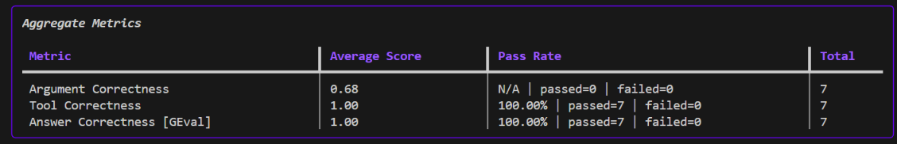
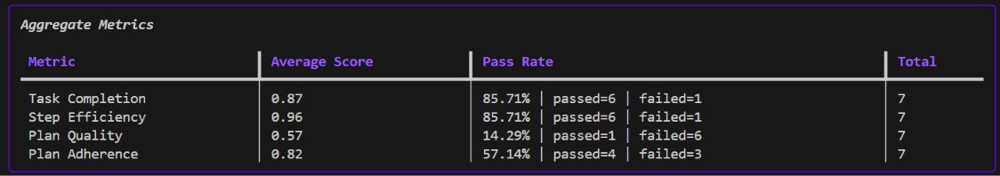

# AI Agent Evaluation System

A small evaluation harness for a customer-support refund agent. The agent
identifies a customer, checks requested purchases against the refund policy,
calculates eligible refund amounts, and issues a ticket when appropriate.

The project uses LangChain for the agent workflow and DeepEval to assess tool
use, final answers, and agent behaviour.

## What the agent handles

- Looks up customer purchase history.
- Validates a purchase against the 30-day refund policy.
- Rejects future-dated, expired, or unpurchased items.
- Calculates refunds for eligible requested items only.
- Issues a refund ticket with the correct amount.

## Evaluation suite

The current dataset contains seven refund-support scenarios, including:

- Eligible single- and multi-item refunds.
- A request with both an eligible and an expired item.
- An expired purchase.
- An item the customer did not purchase.
- An invalid customer.
- A non-refund purchase-history request.

Run the complete evaluation suite with:

```powershell
uv run python evaluations/eval_all.py
```

Before running it, add an `OPENAI_API_KEY` value to `.env` (see
[.env.example](.env.example)).

## Latest evaluation results

These results are from the seven scenarios in the current dataset. They are a
useful regression check—not a claim that the agent is universally perfect.

### Correctness metrics

| Metric | Score | Result | What it measures |
| --- | ---: | --- | --- |
| Tool correctness | 1.00 | 7/7 passed | Whether the expected tools and their inputs were used. |
| Answer correctness (GEval) | 1.00 | 7/7 passed | Whether the final conclusion matches the expected outcome. |
| Argument correctness | 0.68 | No pass-rate shown | Quality of the arguments supplied to tool calls. |



### Agent behaviour metrics

| Metric | Score | Result | Interpretation |
| --- | ---: | --- | --- |
| Task completion | 0.87 | 6/7 passed | The agent completed most intended tasks. |
| Step efficiency | 0.96 | 6/7 passed | The execution path was generally concise. |
| Plan quality | 0.79 | 1/7 passed | Planning needs improvement. |
| Plan adherence | 0.82 | 4/7 passed | The agent did not consistently follow its own plan. |



## How to read the 100% scores

Yes, the two `100%` results are valid for this evaluation run—but only for the
specific metrics and seven test cases above:

- **Tool correctness: 100%** means the agent selected the expected tools and
  passed the expected inputs in all seven scenarios.
- **Answer correctness: 100%** means each final response reached the same
  logical outcome as its expected answer.

They do **not** mean the whole agent is perfect. The lower plan-quality and
plan-adherence pass rates show where the next improvements should focus:
making the agent's reasoning plan clearer and ensuring it follows that plan
consistently. The `0.68` argument-correctness score is another signal to add
more varied test cases and inspect tool-input construction.

## Project layout

```text
agent/          Refund agent, tools, prompts, and customer fixture data
evaluations/    Dataset and DeepEval metric runner
docs/images/    Saved evaluation-result screenshots
```

## Extending the evaluation

To make the results more representative, add scenarios for boundary dates
(exactly 30 days old), ambiguous item names, repeated requests, malformed
usernames, and multiple eligible items. Re-run the suite after each prompt or
tool change to catch regressions.
